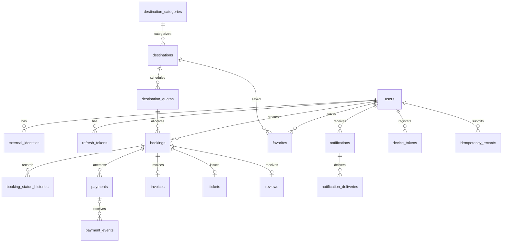
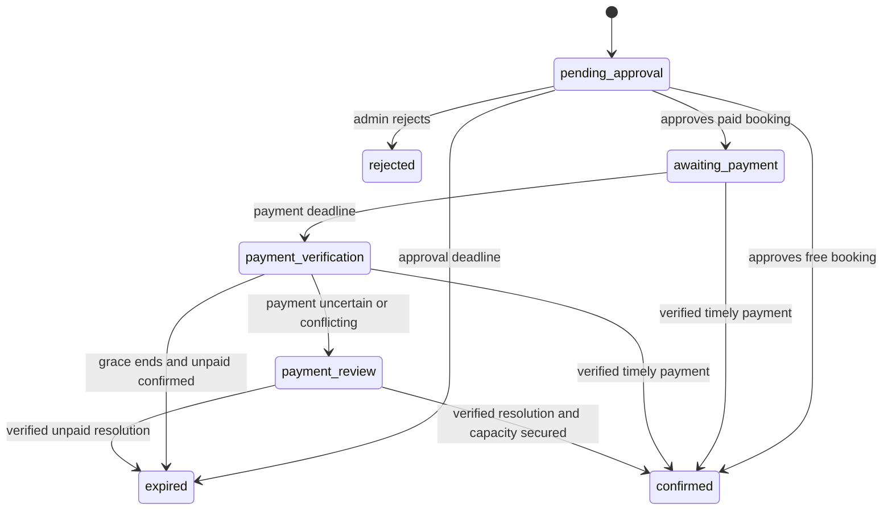

# PRD — Wisata Daerahku Backend API

Tanggal: 29 Oktober 2026. Fokus: pengembangan backend terlebih dahulu. Dokumen ini instruksi implementasi, bukan laporan bahwa backend sudah dibangun.

## 1. Tujuan dan batas scope

Bangun Laravel 13 API + MySQL sebagai sumber kebenaran identitas internal, role, destinasi, kategori, booking, kuota, pembayaran, invoice, tiket, dan notifikasi. Flutter mengonsumsi API; tidak ada frontend, Blade UI aplikasi, SPA, atau pekerjaan build AAB pada scope ini. Template server untuk email/PDF diperbolehkan.

Firebase dipertahankan khusus Google Sign-In dan Firebase Cloud Messaging (FCM). Firestore dan Firebase Storage tidak menjadi penyimpanan bisnis baru. Jangan menghapus proyek Firebase, mengubah database lama, atau memigrasikan data produksi tanpa rencana migrasi tersendiri. Apakah data lama diimpor masih belum diputuskan.

Payment gateway belum dipilih: kandidat DOKU atau Midtrans. Implementasikan modul independen yang sudah jelas; integrasi provider nyata menunggu pilihan dan konfigurasi. Jangan mengaktifkan kedua provider sekaligus atau menganggap mock payment sebagai integrasi produksi.

## 2. Instruksi untuk Codex dan subagents

Baca AGENTS.md, konfigurasi proyek, composer.json, dan skills terminal sebelum mengubah kode. Gunakan skill Ponytail (ponytails sesuai nama instalasi lokal): prioritaskan fitur Laravel/MySQL dan dependency yang sudah tersedia. Hindari generic repository, microservices, factory/interface spekulatif, serta abstraksi tanpa kebutuhan nyata. Kesederhanaan tidak boleh mengurangi validasi, authorization, idempotency, atau integritas uang/kuota.

Temukan dan baca konfigurasi berikut dalam `.codex` proyek atau direktori konfigurasi Codex pengguna; gunakan nama/path yang benar-benar ditemukan:

| Agent | Tanggung jawab |
|---|---|
| master_orchestrator | Membagi pekerjaan, menetapkan kontrak lintas modul, integrasi dan laporan akhir |
| system_architect | Finalisasi schema, state machine, API contract, batas transaksi dan urutan lock |
| backend_engineer | Implementasi migrations, services, controllers, requests, resources, jobs dan integrasi |
| qa_engineer | Pengujian alur, boundary waktu, idempotency dan concurrency MySQL |
| security_auditor | Review auth/JWT, role, ownership, webhook, storage dan kebocoran data |

Jalankan tugas independen paralel setelah schema/kontrak disepakati; hindari dua agent mengedit file yang sama. Review security dan QA dapat berjalan bersamaan pada modul yang selesai. Jika konfigurasi agent tidak tersedia, laporkan dan gunakan pembagian peran setara; jangan mengklaim telah membaca konfigurasi yang tidak ditemukan. Pada penyusunan PRD ini konfigurasi lokal tersebut belum tersedia di workspace.

## 3. Struktur wajib

Alur utama: `routes/api.php → FormRequest → Controller → Service → Resource`.

- **Controllers:** hanya orkestrasi tipis. Constructor injection service; terima FormRequest/parameter route, panggil service, dan kembalikan Resource/ResourceCollection. Tidak menjalankan query, transaksi, aturan bisnis, atau perhitungan harga.
- **Services:** pusat CRUD, aturan data, transaksi, authorization bisnis, transisi status, koordinasi queue, dan penanganan error domain. Service tidak menghasilkan response JSON/HTTP. Pecah menurut domain, bukan satu service raksasa.
- **Resources:** hanya serialisasi JSON dari hasil service, tanpa query tersembunyi, mutation, perhitungan kuota/harga, atau keputusan bisnis. Service memuat relasi dan data turunan yang diperlukan.
- **Requests:** FormRequest untuk validasi input dan izin request yang relevan. Aturan yang bergantung pada kondisi database bersamaan tetap diperiksa service dalam transaksi.
- **Models:** pemetaan database, relasi, casts, scopes sederhana. Policy/middleware untuk authorization terpusat, dipanggil sebelum operasi sensitif.
- **Jobs/Commands:** entry point tipis yang memanggil service. Scheduler mengoordinasikan expiry/reconciliation; bukan tempat duplikasi aturan bisnis.
- **Errors:** service melempar exception domain; handler Laravel memetakan ke format JSON konsisten. Jangan menyembunyikan exception atau mengembalikan HTTP 200 untuk kegagalan.

Exception transport: unduhan PDF dapat memakai binary response dan webhook dapat memakai acknowledgment sesuai provider; jangan membungkus file dalam Resource JSON. Logic tetap berada pada service.

Folder yang relevan: `app/Http/Controllers/Api/V1`, `app/Http/Requests`, `app/Http/Resources`, `app/Services`, `app/Models`, `app/Policies`, `app/Jobs`, `app/Console/Commands`, `database/migrations`, `tests`, `routes/api.php`. Jangan menyentuh Flutter.

## 4. Database dan aturan identitas

Semua nama tabel/kolom berbahasa Inggris. Semua PK tabel domain bernama `guid`, memakai UUID v4 yang dibuat server. FK bernama deskriptif `*_guid`, tipe sama dengan PK tujuan. Jangan memakai UUID versi lain tanpa alasan dan persetujuan perubahan requirement. UUID tidak menggantikan ownership check.

Gunakan unique constraints, FK, indeks query aktual, dan MySQL transactions. Semua nilai uang IDR adalah integer rupiah, bukan float/string berformat. Timestamp disimpan konsisten (UTC), ditampilkan dengan offset; tanggal kunjungan mengikuti zona waktu destinasi. Rahasia tidak masuk repository atau JSON response.

### Tabel domain

| Tabel | Kolom utama selain timestamps |
|---|---|
| users | guid, name, email unique, phone nullable, password nullable (hash), role, status, email_verified_at nullable |
| external_identities | guid, user_guid, provider, provider_subject; unique(provider, provider_subject) |
| refresh_tokens | guid, user_guid, token_hash unique, session_guid, device_name, expires_at, revoked_at, replaced_by_guid nullable |
| destination_categories | guid, name, slug unique, is_active |
| destinations | guid, destination_category_guid, name, location, description, ticket_price, currency, opening_hours, timezone, image_path nullable, is_active |
| destination_quotas | guid, destination_guid, visit_date, capacity, booking_opens_at, booking_closes_at; unique(destination_guid, visit_date) |
| bookings | guid, user_guid, destination_quota_guid, booking_number unique, quantity, visitor_name, visitor_email, visitor_phone, destination_name_snapshot, unit_price, total_amount, currency, notes nullable, status, approval_expires_at, payment_expires_at nullable, notification_grace_expires_at nullable |
| booking_status_histories | guid, booking_guid, actor_guid nullable, old_status, new_status, reason nullable, created_at |
| payments | guid, booking_guid, provider, merchant_reference unique, provider_reference nullable, amount, currency, status, expires_at, paid_at nullable |
| payment_events | guid, payment_guid nullable, provider, deduplication_key, processing_status, received_at, processed_at nullable; unique(provider, deduplication_key) |
| invoices | guid, booking_guid unique, invoice_number unique, status, pdf_path nullable, issued_at |
| tickets | guid, booking_guid unique, token_hash unique, status, issued_at, expires_at nullable |
| favorites | guid, user_guid, destination_guid; unique(user_guid, destination_guid) |
| reviews | guid, booking_guid unique, rating, body; eligibility masih perlu diputuskan |
| notifications | guid, user_guid, booking_guid nullable, event_key, type, title, body, read_at nullable; unique(user_guid, event_key) |
| device_tokens | guid, user_guid, token unique, platform, last_seen_at |
| idempotency_records | guid, user_guid, operation, key, request_hash, status, response_reference, expires_at; unique(user_guid, operation, key) |
| notification_deliveries | guid, notification_guid, channel, target_key, status, attempts, next_attempt_at nullable, last_error_code nullable; unique(notification_guid, channel, target_key) |

Booking merujuk baris kuota melalui destination_quota_guid sehingga tanggal dan destinasi memiliki satu sumber relasi. API tetap menampilkan destination_guid dan visit_date. Schema ini menyempurnakan rancangan awal yang mengulang tanggal/destinasi pada booking. Snapshot nama/harga/kontak sengaja disimpan untuk riwayat transaksi.

Rancangan awal mengimplementasikan kapasitas eksplisit per tanggal; kapasitas wajib ditentukan admin, tidak ada default 100 dan tidak ada pembagian acak. Jika mode tanpa batas dibutuhkan, definisikan eksplisit sebelum menambahkannya. Kuota yang belum disiapkan bukan otomatis unlimited.

Tabel infrastruktur bawaan Laravel dapat mempertahankan format yang diwajibkan driver/package; dokumentasikan pengecualian itu, jangan mengubah kontrak vendor demi mengganti nama kolom.

### ERD relasi utama

## 5. Authentication dan authorization

- Satu identitas users untuk role integer: 0 user, 1 admin, 2 superadmin. Public register selalu role 0; tolak input privilege dari client.
- Login email/password Laravel dan Google melalui Firebase sama-sama menerbitkan JWT Laravel. Firebase ID token hanya untuk pertukaran identitas, bukan token API bisnis.
- Verifikasi signature, issuer, audience, expiry dan project Firebase; hanya terima provider Google pada endpoint Google. Gunakan library kompatibel dan terpelihara, bukan verifikasi kriptografi buatan sendiri.
- Kaitkan external identity berdasarkan subject terverifikasi. Jangan otomatis menggabungkan akun hanya karena client mengirim email yang sama. Linking akun existing membutuhkan bukti kepemilikan yang aman.
- JWT access berumur pendek; refresh token tersimpan hash, dirotasi secara atomik, dengan deteksi reuse dan pencabutan sesi. Validasi algorithm allowlist, signature, issuer, audience dan expiry. Putuskan TTL saat konfigurasi implementasi dan dokumentasikan.
- Logout, reset password, suspend akun dan perubahan privilege harus memiliki strategi pencabutan efektif, termasuk pemeriksaan sesi/status akun untuk endpoint penting.
- User hanya mengakses miliknya. Admin mengelola destinasi, kuota dan keputusan booking; superadmin juga mengelola kategori dan admin. Scope admin lintas destinasi harus ditulis eksplisit pada policy, jangan menerima role dari request sebagai bukti hak.
- Bootstrap superadmin melalui command/proses server yang aman, tidak ada kredensial default hardcoded.
- Siapkan register/login/me/refresh/logout, profil, email verification dan forgot/reset password. Mekanisme verifikasi/reset gunakan fitur Laravel yang sesuai; jangan mengasumsikan OTP enam digit sudah diminta.

## 6. Booking, kuota dan lifecycle

Satu booking adalah rombongan milik satu user. quantity wajib integer positif; anggota lain tidak perlu akun/nama. Total dihitung server dari harga dan quantity. Nominal client bukan sumber kebenaran. Kapasitas dihitung jumlah orang, bukan jumlah booking.

- Buat booking: validasi destinasi/kategori aktif, tanggal dan jendela booking, harga dan sisa kapasitas; tahan quantity; status pending_approval.
- Admin menyetujui/menolak maksimal 24 jam sejak booking dibuat. Setelah deadline, approval ditolak meskipun scheduler belum berjalan.
- Approved berbayar menjadi awaiting_payment: deadline pembayaran 1 jam sejak approval. Gratis langsung confirmed.
- Setelah 1 jam, checkout baru ditutup dan status masuk payment_verification; hold tetap ada selama grace 15 menit. Grace bukan tambahan waktu bayar.
- Pembayaran valid tepat waktu: hold berubah menjadi confirmed, tanpa mengurangi kapasitas dua kali.
- Rejected atau expired yang aman dipastikan: hold dilepas sekali.
- Payment yang belum pasti: payment_review, tetap menahan kuota menurut kesepakatan sementara; beri alert admin. Batas maksimum penanganan kasus ini masih belum diputuskan dan menjadi release gate.

Tidak menerima approval/payment yang membuat kunjungan terkonfirmasi setelah waktu kunjungan yang valid. Definisikan cutoff booking/approval dengan memperhitungkan 24 jam + 1 jam + 15 menit; jangan diam-diam membiarkan expiry melewati tanggal kunjungan. Kebijakan konkret cutoff harus difinalisasi sebelum modul booking dirilis.

## 7. Race condition dan idempotency wajib

Semua operasi perubahan alokasi kuota mengunci baris destination_quotas yang sama dan menggunakan urutan lock konsisten (quota lalu booking, kemudian payment bila perlu). Cek sisa dan simpan hold dalam satu transaksi. Jangan memanggil gateway/SMTP/FCM sambil menahan lock database.

Implementasi awal boleh menghitung quantity booking berstatus yang mengalokasikan kuota melalui query terindeks, di dalam critical section yang sama. Expiry waktu tidak boleh membuat hold dianggap lepas sebelum transisi status/rekonsiliasi yang benar. Jika memilih counters, semua perubahan counters wajib atomik dan teruji; jangan membuat dua sumber kebenaran tanpa kebutuhan.

Idempotency-Key untuk create booking dan checkout: scope user+operation+key; simpan fingerprint input dan hasil. Key sama/input sama mengembalikan hasil pertama; input berbeda 409. Request bersamaan hanya satu yang menjalankan operasi. Simpan referensi transaksi gateway sebelum call; timeout memicu pengecekan referensi itu, bukan checkout baru otomatis.

Webhook dan reconciliation menggunakan service konfirmasi yang sama. Deduplikasi event bukan berarti mengabaikan perubahan status berbeda pada transaksi sama. Status sukses tidak boleh turun menjadi pending akibat event lama. Unique booking_guid pada invoice/tiket dan unique event notification mencegah output ganda. Release hold juga harus idempotent. Tangani deadlock dengan retry terbatas.

## 8. Payment dan notifikasi terlambat

Batas pembayaran server dan expiry gateway harus selaras berdasarkan kemampuan provider. Pada grace berakhir, query status gateway. Timestamp pembayaran yang sah berasal dari gateway, bukan client atau waktu penerimaan webhook.

Verifikasi webhook mengikuti dokumentasi provider: autentisitas, merchant reference, jumlah, currency, status, serta waktu pembayaran. Ack hanya setelah event tersimpan durable; proses ulang aman jika worker gagal. Jangan membuat format signature/dedup key berdasarkan asumsi sebelum provider dipilih.

Webhook yang tiba setelah 15 menit tetap diterima dan direkonsiliasi; jangan membuang bukti uang masuk. Pembayaran terlambat, dua percobaan yang sama-sama dibayar, nominal mismatch atau kuota yang sudah habis tidak otomatis menerbitkan tiket. Catat payment_review dan tindak lanjut refund/manual. Jangan mencatat refund berhasil sebelum gateway mengonfirmasi. Automatic refund dan cancellation setelah lunas belum disepakati.

## 9. Storage, invoice, PDF, email dan FCM

Gambar destinasi lewat API tervalidasi (ukuran, jenis MIME, konten file). Pilih storage disk dari konfigurasi; tidak perlu CDN/Cloudinary baru tanpa kebutuhan. Invoice dan tiket bersifat private; akses download memerlukan ownership/role. Nama/path file tidak berasal langsung dari input tak tepercaya.

Generate invoice PDF dan tiket rombongan paling banyak satu per booking sesuai unique constraint. Rekomendasi awal: dokumen konfirmasi/PDF setelah confirmed, melalui job idempotent. Waktu penerbitan invoice tagihan sebelum pembayaran vs bukti lunas perlu difinalisasi; jangan mengklaim invoice sebagai bukti uang masuk hanya karena file berhasil dibuat.

FCM disetujui; Pusher tidak termasuk tahap awal. notifications menjadi inbox permanen di MySQL. device_tokens didaftarkan lewat JWT, mendukung beberapa perangkat, refresh token perangkat, logout/ganti akun dan token invalid. Token FCM tidak boleh menjadi identitas login.

Event minimal: booking baru untuk admin, disetujui/ditolak/kedaluwarsa untuk pemesan, pembayaran terkonfirmasi, dan payment_review untuk admin. Payload push minimal, memakai notification_guid/booking_guid; Flutter mengambil data terbaru dari API. Jangan kirim data sensitif ke public topic.

Email dan FCM memakai queue; kegagalan pengiriman tidak membatalkan booking/payment. Gunakan notification_deliveries sebagai pekerjaan pengiriman durable yang dicatat bersama transaksi domain; dispatcher/jobs mengambil dan retry dengan backoff, failed-job monitoring. Hindari celah commit sukses tetapi job belum tercatat. Pengiriman eksternal dapat terduplikasi saat acknowledgment hilang; jangan menjanjikan exactly-once delivery. Gunakan notification_guid stabil untuk deduplikasi client.

## 10. API contract minimum

Prefix `/api/v1`, response konsisten, pagination daftar, allowlist sorting/filter, error 401/403/404/409/422/429 sesuai kasus. Semua response lewat Resource kecuali file download dan webhook acknowledgment.

- Auth: register, login, google exchange, refresh, logout, me, verification dan reset password.
- Profile: baca/update profil; penutupan akun dengan kebijakan data transaksi, bukan cascade delete pembayaran.
- Categories: list aktif; CRUD/deactivation superadmin.
- Destinations: list/detail/search/filter category; CRUD/deactivation admin.
- Quotas: list/upsert kapasitas per tanggal oleh admin; larang capacity turun di bawah alokasi.
- Bookings: create, list/detail milik user; list/admin approve/reject. Jangan menyediakan PATCH status bebas.
- Payments: create checkout dan status milik user; webhook provider terpisah dengan verifikasi autentisitas.
- Documents: invoice/ticket metadata dan authorized download.
- Notifications: list, unread count, mark read; register/update/unregister device.
- Favorites: add/remove/list secara idempotent.
- Admin accounts: create, suspend, update role oleh superadmin; lindungi superadmin terakhir.

Review eligibility dan check-in belum diputuskan: jangan membuka endpoint ulasan hanya karena approved. Favorites boleh langsung diimplementasi. Sediakan schema review hanya saat aturan diselesaikan, tidak perlu scaffolding feature yang belum siap.

## 11. Acceptance dan pengujian

Gunakan test framework yang sudah ada; QA fokus risiko nyata, bukan test yang menyalin implementasi.

- Role escalation ditolak; akun A tidak dapat membaca booking/invoice/token akun B dengan UUID yang diketahui.
- Google token salah/expired/project salah ditolak; refresh rotation, reuse, logout dan suspend teruji.
- Kapasitas 6, dua request berbeda quantity 4 bersamaan: tepat satu berhasil; test memakai MySQL nyata, bukan hanya SQLite.
- Retry create booking tidak menggandakan hold; key sama payload beda ditolak.
- Approval vs expiry bersamaan, payment vs release bersamaan, dua webhook sama, status webhook terbalik, serta dua pembayaran sukses: tidak oversell/double release/double ticket.
- Boundary tepat sebelum/pada/setelah 24 jam, 1 jam dan 15 menit menggunakan clock terkendali; dokumentasikan aturan batas secara konsisten.
- Grace berakhir dengan gateway down menghasilkan review, bukan klaim unpaid.
- Email/FCM/PDF gagal bisa retry tanpa mengubah fakta pembayaran atau membuat invoice/tiket baru.
- Logout/ganti akun tidak mengirim notifikasi private ke user sebelumnya; path PDF privat tidak dapat ditebak untuk bypass akses.

Sertakan dokumentasi setup, .env.example tanpa secrets, API examples/OpenAPI ringkas, perintah migration/worker/scheduler, dan hasil checks yang benar-benar dijalankan. Jangan deploy otomatis.

## 12. Tahapan dan keputusan yang masih terbuka

1. Architect menetapkan schema/kontrak; backend membuat fondasi UUID, error format, auth, role dan policies.
2. Backend membangun categories, destinations, quotas, booking state machine dan idempotency; QA concurrency, security review paralel.
3. Notification inbox, device registration, queue delivery, storage dan PDF. Integrasi FCM nyata membutuhkan credential environment.
4. Setelah gateway dipilih: checkout, webhook, expiry reconciliation, end-to-end sandbox.
5. Integrasi dan dokumentasi operasional; pastikan semua release gate selesai sebelum produksi.

Keputusan terbuka tidak menghambat modul independen: provider payment; cancellation/refund; durasi maksimum payment_review dan prosedur operator; cutoff sebelum hari kunjungan; waktu/form invoice; impor Firebase lama; check-in dan review eligibility; storage/SMTP deployment credentials. Jangan mengubah pertanyaan terbuka menjadi requirement final tanpa menyatakannya. Implementasikan backend saja; target AAB/Play Store merupakan fase mobile berikutnya.
