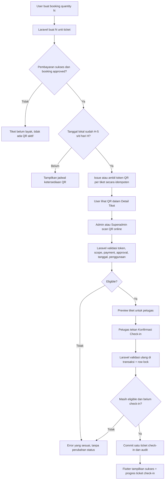

# PRODUCT REQUIREMENTS DOCUMENT (PRD)
# Wisata Daerahku — Smart Ticket QR Check-in V1

**Tanggal:** 3 November 2026  
**Status:** Approved requirements / ready for implementation  
**Platform:** Flutter Mobile (Android-first) + Laravel 13 REST API + MySQL  
**Prioritas:** Feature development / incremental migration, bukan redesign sistem booking  
**Target repositori:**
- Flutter: https://github.com/koyotot/pami-wisata-daearahku
- Laravel: https://github.com/joytimess/pami-wisata-daerahku-api

**Nama file:** `PRD-Wisata-Daerahku-Smart-Ticket-QR-Checkin-V1.md`

> **Instruksi utama:** Implementasikan QR per tiket, bukan QR per booking. Check-in hanya boleh dilakukan petugas Admin/Superadmin melalui scan QR pada hari kunjungan, online, setelah preview dan konfirmasi eksplisit. Jangan pertahankan jalur self-check-in yang memungkinkan User menandai tiketnya sendiri. Jaga seluruh business logic booking, pembayaran, kuota, riwayat, review, notifikasi, dokumen, dan UI V4 yang masih relevan. Jangan jalankan QA agent, full regression, full test suite, atau loop analisis yang berat.

---

## 1. Ringkasan masalah dan tujuan

### 1.1 Kondisi saat ini (berdasarkan `main` publik yang diperiksa 3 Nov 2026)

1. Flutter menggunakan `BuktiPendaftaranScreen` untuk detail tiket; `BusinessRepository.checkIn(bookingGuid)` memanggil `POST /api/v1/bookings/{booking}/check-in` dan User memiliki tombol check-in ketika `can_check_in`.
2. Laravel `VisitController` / `VisitService` mengizinkan check-in tingkat **booking**, satu record pada tabel `check_ins` per booking. `VisitService.review()` mensyaratkan adanya record `check_ins` untuk booking tersebut.
3. Laravel menghasilkan PDF tiket rombongan secara privat. README yang dipublikasikan masih menyebut payment gateway belum diimplementasikan; rencana DOKU Sandbox + Demo Simulator ada sebagai requirement terpisah. Kondisi kode **lokal** mungkin sudah lebih baru dan wajib dibaca sebelum implementasi.
4. Admin pada baseline publik tampak bisa memproses booking lintas destinasi; belum boleh diasumsikan sudah ada relasi admin–destinasi. Fitur scanner V1 harus menerapkan scope khusus sesuai keputusan produk.
5. `pubspec.yaml` publik belum mencantumkan `mobile_scanner` dan `flutter_svg`; `composer.json` publik belum mencantumkan `bacon/bacon-qr-code`. Periksa instalasi lokal dahulu.

**Referensi aktual:**
- Flutter `pubspec.yaml`: https://github.com/koyotot/pami-wisata-daearahku/blob/main/pubspec.yaml
- Flutter `lib/data/business_repository.dart`: https://github.com/koyotot/pami-wisata-daearahku/blob/main/lib/data/business_repository.dart
- Flutter `lib/screens/bukti_pendaftaran_screen.dart`: https://github.com/koyotot/pami-wisata-daearahku/blob/main/lib/screens/bukti_pendaftaran_screen.dart
- Backend `routes/api.php`: https://github.com/joytimess/pami-wisata-daerahku-api/blob/main/routes/api.php
- Backend `app/Services/VisitService.php`: https://github.com/joytimess/pami-wisata-daerahku-api/blob/main/app/Services/VisitService.php
- Backend `composer.json`: https://github.com/joytimess/pami-wisata-daerahku-api/blob/main/composer.json

### 1.2 Problem statement

User dapat membeli beberapa tiket sekaligus, tetapi check-in lama menggunakan status satu booking dan belum mewajibkan bukti QR yang dipindai petugas. Proses di gerbang menjadi bergantung pada pencarian/penyebutan booking code `BK-XXXXX`, rawan antrean, check-in keliru, atau check-in sendiri oleh User.

### 1.3 Sasaran

- Satu **unit tiket** = satu identitas `ticket_guid` + satu QR rahasia unik. Booking quantity 4 menghasilkan **empat QR**, masing-masing bisa check-in independen.
- Laravel adalah sumber kebenaran atas eligibility, issue H-5, QR, status bayar, approval, tanggal, role/scope, dan single-use check-in.
- User membuka QR dari Detail Tiket di Flutter. Tidak perlu mengetik atau menyerahkan booking code kepada petugas.
- Petugas scan, melihat preview dari server, memeriksa, lalu menekan **Konfirmasi Check-in**; scan awal tidak mengubah status.
- Riwayat dan fitur terkait menggunakan agregasi jumlah tiket `checked_in / total`; data historis tetap berfungsi.

---

## 2. Keputusan bisnis final — tidak perlu ditanya ulang

| ID | Area | Keputusan final |
|---|---|---|
| BR-01 | Granularitas | **Satu QR unik per tiket**, bukan per booking; quantity N = N tiket |
| BR-02 | Waktu terbit | Mulai **H-5 kalender lokal destinasi** |
| BR-03 | Kelayakan terbit | **Pembayaran sukses/lunas DAN booking disetujui/confirmed** |
| BR-04 | Persetujuan/pembayaran telat | Jika kedua syarat terpenuhi setelah H-5, QR tersedia segera, termasuk H-2 atau hari H |
| BR-05 | Waktu scan | Hanya pada **hari H** menurut timezone destinasi, 00:00–23:59:59 setempat (V1 tanpa jam operasional khusus) |
| BR-06 | Habis berlaku | Setelah hari H, QR tidak bisa dipakai untuk check-in |
| BR-07 | Scanner | **Scan → validasi/preview → konfirmasi manual → commit** |
| BR-08 | Scope role | Admin (role 1) hanya destinasi yang dikelolanya; Superadmin (role 2) semua destinasi |
| BR-09 | Internet | Scanner **online-only**, tidak ada offline queue |
| BR-10 | QR | **Secure static QR**, token acak, unik, tidak berotasi, sekali pakai |
| BR-11 | Identitas token | QR bukan `BK-XXXXX`, bukan ticket GUID mentah, tidak membawa PII |
| BR-12 | Keamanan | Penolakan replay, double scan, stale preview, concurrent scan, booking tidak layak, role tidak sah |
| BR-13 | Antarmuka | Ikuti `docs/DESIGN.md` Flutter, UI V4, edge-to-edge dan pola existing |
| BR-14 | Agents/testing | Maksimal dua specialist `backend_engineer` dan `flutter_engineer`; tanpa QA agent, full regression, atau pengujian berat |

### 2.1 Detail terminologi

- **Booking:** satu transaksi dengan quantity N dan snapshot pemesan.
- **Ticket:** satu unit hak masuk, urutan 1..N. V1 **tidak** membuat data nama individual untuk masing-masing penumpang bila sistem saat ini hanya menyimpan nama pemesan. Preview menampilkan *pemesan* dan `Tiket #i dari N`, bukan mengklaim nama pribadi pengunjung ke-i.
- **Issued:** token QR untuk unit tiket telah diterbitkan, belum berarti sudah boleh dipakai pada H-5; pemakaian hanya hari H.
- **Checked in:** satu unit tiket berhasil masuk via konfirmasi petugas.
- **Paid:** status pembayaran otoritatif yang diperoleh dari Laravel/payment adapter, **bukan** field kiriman Flutter dan bukan sekadar `booking.status=confirmed`.

---

## 3. User stories & acceptance

**US-01 (User):** Sebagai pembeli 4 tiket, saya dapat membuka 4 QR berbeda, melihat indeks masing-masing dan status check-in satu per satu. Tidak ada tombol *Check-in sendiri*.

**US-02 (User):** Sebelum H-5, jika booking sudah lunas dan confirmed, Detail Tiket menampilkan tanggal QR akan tersedia, bukan kode QR. Setelah H-5, kode siap. Setelah hari H atau tiket sudah digunakan, status jelas dan QR tidak boleh dipakai untuk check-in ulang.

**US-03 (Admin):** Saya memindai QR menggunakan kamera di aplikasi Flutter, melihat preview tiket dan konfirmasi, tetapi hanya untuk destinasi yang menjadi penugasan saya.

**US-04 (Superadmin):** Saya memindai seluruh destinasi dan setiap tindakan tercatat dengan pelaku dan waktu server.

**US-05 (Sistem):** Satu QR tidak dapat menyebabkan dua check-in bahkan jika dipindai pada dua perangkat pada waktu hampir bersamaan.

**US-06 (Sistem):** Review, riwayat, statistik profil, dokumen, dan booking lama tetap memiliki makna setelah migrasi dari booking-level check-in.

---

## 4. Alur utama end-to-end



### 4.1 Contoh booking quantity 4

- Booking `BK-...` dibuat dengan `quantity=4` → unit tiket 1, 2, 3, dan 4 dibuat.
- Token QR **berbeda** untuk tiap unit.
- Petugas scan tiket 2 → tiket 2 `checked_in`, sedangkan 1, 3, 4 tetap `not_checked_in`.
- Agregasi booking menampilkan `1/4 sudah check-in`, bukan seluruh rombongan tiba.
- Tiket 2 scan ulang → `409 ticket_already_checked_in`; tiket lain tetap bisa digunakan.
- Bila order menggunakan data nama pemesan tunggal, identitas yang terlihat adalah *Nama pemesan*, bukan nama individu tiket 2.

---

## 5. Timing H-5, hari H, dan timezone

**Sumber:** `destination_quotas.visit_date` dan `destinations.timezone` dari Laravel. Jangan gunakan waktu perangkat pengguna untuk memutuskan keabsahan.

Contoh `visit_date = 2026-11-20`, timezone `Asia/Jakarta`:

| Tanggal lokal | QR terlihat jika paid+approved? | Check-in? |
|---|---:|---:|
| 14 Nov (H-6) | Tidak | Tidak |
| 15 Nov (H-5) | Ya | Tidak |
| 19 Nov (H-1) | Ya | Tidak |
| 20 Nov (H) | Ya | Ya, jika tiket belum digunakan |
| 21 Nov (H+1) | Status historis/expired saja | Tidak |

**Implementasi issuance:**
1. Buat record `booking_tickets` bersama booking (belum ada secret QR yang dapat digunakan), satu row untuk setiap quantity. Buat di dalam transaksi booking idempoten; replay booking tidak menduplikasi tiket.
2. Scheduler/command yang idempoten menyiapkan token untuk tiket dengan syarat paid+approved saat mencapai H-5 menurut timezone masing-masing destinasi. Gunakan batching; tidak perlu generate gambar statis permanen untuk setiap ticket.
3. **Lazy fallback:** endpoint GET tiket/QR memastikan issuance saat diminta dan layak, sehingga QR langsung tersedia jika pembayaran/approval baru selesai pada H-2/hari H atau scheduler lokal tidak sedang hidup.
4. Race antara scheduler dan GET dikunci DB + uniqueness; token yang sudah diterbitkan **tetap sama**, tidak ter-rotate hanya karena halaman di-refresh.
5. Setelah H, jangan menerbitkan token baru atau memperbolehkan check-in. Data ticket historis tetap dapat ditampilkan tanpa mengungkap QR aktif.
6. Jika timezone destinasi berubah untuk booking historis, gunakan timezone snapshot saat booking bila tersedia; jika tidak, pertahankan perilaku existing dan hindari mutasi tanggal booking lama tanpa migrasi yang jelas.

**Batas fitur V1:** tidak ada early check-in pada H-5, tidak ada toleransi H+1, tidak ada perubahan waktu scan karena jam operasional destinasi, kecuali pengembangan lanjutan yang disetujui.

---

## 6. Payment/approval gating — integrasi DOKU

Fitur ini harus mengikuti alur DOKU Sandbox + Demo Simulator yang **direncanakan**, bukan mengasumsikan sudah terpasang.

- **Wajib** ada otoritas status pembayaran di Laravel. Hanya `paid/succeeded/settled` **sesuai definisi adapter pembayaran aktual** yang dianggap lunas; `pending`, `failed`, `expired`, `refunded`, atau `unverified` ditolak.
- `booking.status=confirmed` **tidak otomatis** berarti `payment_status=paid`.
- Untuk skenario demo, adapter simulator backend boleh menandai `paid` **hanya dari jalur simulator berotorisasi**, tidak dari input bebas Flutter atau query param.
- Jika modul payment belum tersedia pada checkout lokal: implementasikan interface/guard yang fail-closed dan state UI **Menunggu pembayaran terverifikasi**. Jangan menerbitkan QR secara palsu. Tandai integrasi payment sebagai prerequisite yang dapat disambungkan ke PRD DOKU.
- Pembayaran yang berhasil tetapi booking masih menunggu persetujuan → QR belum tersedia.
- Booking confirmed tetapi belum paid → QR belum tersedia.
- Setelah refund/cancel/reject atau payment reversal, semua token belum terpakai menjadi **revoked/ineligible** dan scan berikutnya harus ditolak.
- Payment state diverifikasi ulang saat `preview` **dan** `confirm`, sehingga preview lama tidak memberi akses setelah status berubah.

**Semantik invoice existing:** PDF invoice konfirmasi bukan bukti pembayaran secara otomatis. QR check-in adalah credential hak masuk; bukti pembayaran harus mengacu pada record paid dari backend.

---

## 7. Model data / migration Laravel

Gunakan penamaan English dan FK `*_guid`. Periksa migrasi aktual; jangan mengubah PK booking existing atau tabel history secara destruktif.

### 7.1 Tabel baru `booking_tickets`

| Kolom | Tipe / aturan | Keterangan |
|---|---|---|
| `guid` | UUID/string PK | ID unit tiket internal |
| `booking_guid` | FK → `bookings.guid`, indexed | Pemilik booking |
| `sequence` | unsigned integer | 1..quantity dalam booking |
| `qr_token_hash` | char(64), nullable, unique | SHA-256 token mentah untuk lookup scanner |
| `qr_token_encrypted` | text nullable | Secret raw token yang di-encrypt dengan Laravel Crypt untuk render ulang; **jangan simpan plaintext** |
| `qr_issued_at` | timestamp nullable | Waktu terbit server |
| `qr_revoked_at` | timestamp nullable | Dicabut akibat refund/cancel/fraud sesuai kebijakan |
| `checked_in_at` | timestamp nullable | Waktu masuk server UTC |
| `checked_in_by_user_guid` | FK nullable → `users.guid` | Admin/Superadmin yang mengonfirmasi |
| `created_at`, `updated_at` | timestamps | Audit lifecycle |

Constraints:
- `UNIQUE (booking_guid, sequence)`.
- `UNIQUE (qr_token_hash)` untuk token non-null.
- FK restrict/delete behavior sesuai pola history existing; jangan cascade menghapus audit check-in secara tidak sengaja.
- Ticket rows untuk setiap booking idempoten sesuai quantity. Tidak boleh create tiket duplikat saat replay.

### 7.2 Tabel baru `ticket_check_ins` (audit final)

| Kolom | Aturan |
|---|---|
| `guid` | UUID PK |
| `ticket_guid` | FK unique → `booking_tickets.guid` (**single check-in**) |
| `booking_guid` | FK untuk agregasi/report, derived server-side |
| `actor_guid` | FK petugas yang melakukan konfirmasi |
| `checked_in_at` | Timestamp dari server |
| `request_id` / `idempotency_key` | Unique scoped ke petugas atau transaksi sesuai strategi existing |
| `created_at` | timestamp |

`booking_tickets.checked_in_at` dan `ticket_check_ins` harus ditulis **pada transaksi yang sama**. `ticket_check_ins` menjadi audit utama, sekaligus database-level single-use guarantee.

### 7.3 Penugasan Admin ke destinasi

Scope scan final: role 1 dibatasi pada destinasi yang dikelola. Cek lebih dulu apakah sudah ada sumber kebenaran assignment.

- Jika relasi aktif sudah tersedia, **reuse**.
- Bila belum ada, buat `destination_admin_assignments` (`guid`, `destination_guid`, `user_guid`, `created_at`), unique `(destination_guid,user_guid)` dengan role check di Service/Policy; Superadmin dapat mengatur penugasan secara minimal dari pengelolaan admin/destinasi.
- Untuk destinasi baru yang dibuat Admin, penugasan pencipta boleh otomatis dibuat jika sesuai pola otorisasi sekarang; perubahan admin/pengelola harus terekam.
- Untuk destinasi lama, assignment perlu dilakukan Superadmin secara eksplisit. **Jangan fallback “semua admin bisa scan”**. Status tanpa assignment adalah fail-closed untuk role 1.
- Pembatasan scanner ini tidak otomatis memaksa redesign seluruh perizinan CRUD/booking yang tidak masuk lingkup PRD; pastikan tidak menciptakan kontradiksi akses.

### 7.4 Migrasi dari legacy `check_ins`

Jangan drop `check_ins` lama atau menghapus data historis. Buat migrasi/backfill idempoten (boleh command satu kali):
1. Buat `booking_tickets` sejumlah `booking.quantity` untuk booking lama bila belum ada (gunakan batching).
2. Jika sebuah booking mempunyai row legacy `check_ins`, interpretasikan bahwa **seluruh quantity** sebelumnya telah check-in sesuai semantik booking-level lama; tandai setiap unit tiket sebagai sudah masuk, pakai `checked_in_at` dan actor legacy, dan isi audit ticket bila belum ada.
3. Untuk tiket legacy yang sudah check-in, **jangan issue QR baru**.
4. Riwayat, statistik profil, dan review harus membaca agregasi ticket. Selama fase kompatibilitas, fallback ke legacy check-in hanya untuk record yang belum dibackfill; tidak boleh menghitung dua kali.
5. Tidak ada perubahan `booking_guid`, status booking, quantity, harga, quota allocation, atau dokumen historis.
6. Backfill harus aman bila dijalankan ulang tanpa mengubah hasil yang sudah benar.

---

## 8. QR payload, generator & penyimpanan aman

### 8.1 Payload

Gunakan versi dan token rahasia **opaque**, misalnya:

```text
WDR1.<base64url(random_bytes(32))>
```

- QR **bukan** booking code `BK-XXXXX`, `ticket_guid`, URL publik, email, nomor telepon, nama, pembayaran, atau JSON PII.
- Token dibuat `random_bytes(32)` di Laravel; tidak berasal dari `mt_rand()`, timestamp, atau nomor urut.
- Simpan `hash('sha256', $payload)` untuk lookup dan payload terenkripsi Laravel `Crypt::encryptString()` agar dapat di-render ulang tanpa membuat token baru.
- Jika token yang disimpan terdeteksi corrupt/tidak dapat didekripsi, jangan silently menerbitkan ulang token yang mungkin sudah diedarkan; tampilkan error recovery terkontrol/audit.
- Jangan pernah log payload scan, QR SVG, encrypted token, atau mengirimnya ke telemetry/crash reporting.

### 8.2 QR rendering

- Composer: gunakan `bacon/bacon-qr-code` **3.1.x** jika belum tersedia, setelah cek kompatibilitas PHP/ext dan `composer.lock`.
- Laravel menghasilkan **SVG QR** on-demand melalui backend image SVG, tidak perlu `imagick` hanya untuk SVG.
- Endpoint SVG **wajib Bearer auth dan owner check**, `Cache-Control: private, no-store`, bukan public file path/CDN.
- Flutter merender SVG dari authenticated response bytes via `flutter_svg`, tanpa menambahkan kembali `qr_flutter` lama.
- Error correction dan ukuran QR gunakan konfigurasi yang scan-friendly, background putih, foreground gelap, quiet-zone cukup, tanpa gradient/logo di modul QR.
- Jangan hardcode gambar QR dalam asset statis, Firebase Storage, atau path publik.
- Jangan mengandalkan embedded QR di PDF V1: PDF rombongan existing tetap berfungsi; **bukti scan utama** adalah QR pada Detail Tiket. Integrasi QR ke private PDF dapat menjadi enhancement berikutnya jika dibutuhkan.

Package referensi:
- https://packagist.org/packages/bacon/bacon-qr-code
- https://pub.dev/packages/mobile_scanner
- https://pub.dev/packages/flutter_svg

---

## 9. REST API V1 — kontrak usulan

Tetap mengikuti prefix `/api/v1` dan respons JSON wrapper `{"data": ...}` yang digunakan repository. Nama route di bawah merupakan **kontrak baru yang harus ditambahkan**, bukan klaim sudah ada.

### 9.1 User — ticket list

**GET `/api/v1/bookings/{booking_guid}/tickets`** (owner booking, role 0 pada konteks User; backend mengecek ownership, status session, email verification sesuai policy)

Respons contoh (bukan token rahasia):

```json
{
  "data": {
    "booking_guid": "<booking-guid>",
    "visit_date": "2026-11-20",
    "timezone": "Asia/Jakarta",
    "qr_available_from": "2026-11-15",
    "quantity": 4,
    "checked_in_count": 1,
    "ticket_state": "available",
    "tickets": [
      {"guid":"<ticket-guid-1>","sequence":1,"status":"not_checked_in","qr_available":true},
      {"guid":"<ticket-guid-2>","sequence":2,"status":"checked_in","qr_available":false,"checked_in_at":"2026-11-20T01:05:00Z"},
      {"guid":"<ticket-guid-3>","sequence":3,"status":"not_checked_in","qr_available":true},
      {"guid":"<ticket-guid-4>","sequence":4,"status":"not_checked_in","qr_available":true}
    ]
  }
}
```

`ticket_state` contoh: `awaiting_payment`, `awaiting_approval`, `scheduled`, `available`, `partially_checked_in`, `fully_checked_in`, `expired`, `revoked`. Field `qr_available` **berdasar server**. Sesuaikan status map dengan codebase aktual dan dokumentasikan satu canonical mapping. Jangan serialisasi raw token/hash/encrypted.

### 9.2 User — image QR per unit

**GET `/api/v1/bookings/{booking_guid}/tickets/{ticket_guid}/qr`**
- `200 image/svg+xml` jika owner, paid, approved, eligible H-5..H, ticket belum check-in/revoked.
- `403` untuk bukan pemilik, `404` resource tidak ada, `409` belum layak/expired/used sesuai kode.
- Header `Cache-Control: private, no-store`, `X-Content-Type-Options: nosniff`.
- QR diambil dari token existing, tidak berubah ketika fetch/reload.

### 9.3 Admin/Superadmin — preview QR

**POST `/api/v1/admin/ticket-check-ins/preview`**

```json
{"qr_payload":"WDR1.<opaque-token>"}
```

Sukses `200` (tanpa mutasi check-in):

```json
{
  "data": {
    "ticket_guid": "<ticket-guid>",
    "sequence": 2,
    "quantity": 4,
    "destination_name": "Pantai Indah",
    "visit_date": "2026-11-20",
    "timezone": "Asia/Jakarta",
    "booker_name": "Nama Pemesan",
    "payment_status": "paid",
    "booking_status": "confirmed",
    "check_in_status": "not_checked_in",
    "can_confirm": true
  }
}
```

- Preview **tidak** menandai check-in, tidak memunculkan QR raw ke log/response, dan tidak membocorkan data booking di luar scope.
- Periksa role 1+ dan assignment destinasi sebelum mengembalikan PII. Role 0 wajib 403.
- Pesan invalid/unknown token generik; rate-limit endpoint.

### 9.4 Admin/Superadmin — confirm QR

**POST `/api/v1/admin/ticket-check-ins/confirm`**

Headers: `Authorization: Bearer ...`, `Idempotency-Key: <uuid-per-confirm-attempt>`

```json
{"qr_payload":"WDR1.<opaque-token>"}
```

Respons sukses `200` atau `201` sesuai konvensi existing:

```json
{
  "data": {
    "ticket_guid":"<ticket-guid>",
    "booking_guid":"<booking-guid>",
    "sequence":2,
    "quantity":4,
    "status":"checked_in",
    "checked_in_count":2,
    "checked_in_at":"2026-11-20T01:05:00Z",
    "checked_in_by":"<admin-guid>"
  }
}
```

- **Wajib revalidate seluruh guard di transaksi**; preview bukan izin yang berlaku selamanya.
- Same idempotency key + same canonical request/actor → response sukses identik saat retry akibat timeout.
- Same key tetapi payload berbeda → `409 idempotency_conflict`.
- Different key terhadap ticket yang sudah check-in → `409 ticket_already_checked_in`.
- Idempotency state disimpan atomik bersama commit atau menggunakan mekanisme existing yang konsisten; jangan ada window double entry.

### 9.5 Route lama

**`POST /api/v1/bookings/{booking}/check-in` tidak boleh lagi menjadi jalur bypass.** Hapus dari route aplikasi baru atau ubah menjadi respons terkontrol `410 legacy_check_in_disabled` / `403` untuk seluruh role sesuai kompatibilitas, dan migrasikan semua pemanggil Flutter. Jangan membuat user biasa bisa check-in lewat endpoint lama sementara UI menyembunyikan tombol.

`GET bookings/{guid}`, booking resources, profile statistics, dan review mendapat tambahan agregasi `ticket_count`, `checked_in_count`, `is_partially_checked_in`, `is_fully_checked_in`, `can_review` yang kompatibel; jangan memutus field existing yang masih digunakan.

---

## 10. Rules Laravel saat preview dan commit

### 10.1 Periksa selalu

1. Token format valid versi `WDR1`, panjang sesuai aturan, prefix cocok, dan hash ditemukan.
2. Tiket terhubung ke booking dan kuota/destinasi yang ada.
3. Actor login aktif, account status active, role 1/2; role 1 assigned ke destinasi itu, role 2 global.
4. Payment benar-benar `paid` menurut adapter backend; booking `confirmed`/approved; tidak revoked/cancelled/refunded.
5. Hari server di `destinations.timezone` == `visit_date`. H-5 hanya untuk penerbitan/penampilan, bukan hari scan.
6. Ticket belum check-in; tidak ada record `ticket_check_ins` existing.
7. Saat confirm, semua pemeriksaan diulang di lock transaksi MySQL.

### 10.2 Atomisitas / race

- Lokasi pengecekan terakhir di `DB::transaction()`.
- Urutan lock konsisten: parent booking (bila status payment/booking bisa berubah bersamaan), lalu ticket row `FOR UPDATE`, lalu immutable eligibility data; sesuaikan lock order dengan service booking/payment untuk mencegah deadlock. Jika integrasi memakai gateway events, pastikan pembacaan status payment di-lock/dilindungi dari race.
- Unique constraint pada `ticket_check_ins.ticket_guid` sebagai lapis perlindungan terakhir.
- Insert audit, update ticket, dan write idempotency outcome dalam transaksi yang sama; rollback penuh saat satu gagal.
- Preview paralel boleh sama-sama valid; hanya **satu** confirm akhirnya sukses.
- Deadline check-in dihitung ulang di server saat commit, bukan berdasarkan `can_confirm` dari preview.
- Jika operasi commit berhasil tetapi respons putus, retry Idempotency-Key harus mengembalikan hasil yang sama, bukan tiket terhitung dua kali.

### 10.3 Rate limit dan privacy

- Throttle `preview` dan `confirm` per actor/IP sewajarnya; hindari scanning loop > satu request per frame. Jangan blokir gate operasional tanpa pesan yang jelas.
- Jangan return identitas privat sebelum token dan scope lolos; tampilkan info minimal di preview.
- QR token jangan muncul di URL, notification body, analytics, exception stack, file log, query history, atau screenshot diagnostic yang disimpan otomatis.
- Endpoint User token hanya via authorization; `no-store` dan session guard setelah logout/switch akun.
- Screenshot QR **bisa dipakai lebih dulu oleh orang yang memegangnya**. Static QR melindungi replay *setelah check-in pertama*, **bukan** mencegah orang lain menggunakan screenshot lebih dulu. Karena itu preview petugas dan pemeriksaan identitas fisik (jika kebijakan pintu masuk mengharuskan) tetap penting.

---

## 11. State matrix dan error handling

| Kondisi | User Detail Tiket | Petugas scan / API |
|---|---|---|
| Pending bayar | `Menunggu pembayaran` tanpa QR | `409 payment_not_paid` |
| Lunas, pending approval | `Menunggu persetujuan` tanpa QR | `409 booking_not_approved` |
| Lunas+approved sebelum H-5 | `QR tersedia pada <tanggal H-5>` | `409 ticket_not_issued` atau `wrong_visit_date` |
| Lunas+approved pada H-5..H-1 | QR tampil | `409 wrong_visit_date` |
| Lunas+approved pada H | QR tampil, belum digunakan | Preview valid, konfirmasi boleh |
| QR valid tetapi ticket used | `Sudah check-in` + timestamp | `409 ticket_already_checked_in` |
| Scan setelah H | `Kunjungan selesai/expired` | `409 wrong_visit_date`/`ticket_expired` |
| Booking cancel/reject/refund | Tidak ada QR aktif | `409 ticket_revoked` |
| Token rusak/asing | Tidak berubah | `422 invalid_qr` tanpa data pribadi |
| User role 0 memanggil preview/confirm | N/A | `403 forbidden` |
| Admin scan di luar assignment | N/A | `403 ticket_out_of_scope` tanpa detail |
| Scanner offline / timeout | N/A | Pesan `Koneksi terputus`, tombol coba lagi, tidak membuat check-in lokal |
| Kamera permission denied | N/A | Penjelasan izin kamera + opsi buka pengaturan perangkat |
| Kamera menangkap banyak frame | N/A | Flutter freeze/pause setelah satu payload, jangan POST berkali-kali |
| Preview valid, ticket dikonfirmasi perangkat lain | N/A | Saat confirm `409 ticket_already_checked_in`; refresh state |
| Session expired/logout | QR private dibersihkan dari memori / kembali auth | `401`; refresh memakai `AuthSession` existing bila sah |
| Service QR render gagal | Retry/placeholder, bukan QR palsu | Tidak mempengaruhi booking/payment |
| Booking legacy sudah pernah check-in | Semua tiket terlihat `checked_in` setelah backfill | Tidak terbit QR baru, replay ditolak |

**API status:** `401` auth, `403` akses, `404` resource, `409` business conflict, `422` payload invalid, `429` rate limited, `5xx` server. Gunakan format error existing (`code`, `message`, `errors` bila relevan); jangan membuat format baru sembarangan.

---

## 12. Flutter UX — User Detail Tiket

**Entry:** `Daftar Kunjungan / Riwayat` → Detail Tiket (`BuktiPendaftaranScreen` atau komponen aktual yang sekarang digunakan), termasuk entry dari notifikasi.

Pertahankan header scenic/edge-to-edge yang sudah berjalan, status booking, status pembayaran, rincian pengunjung, tanggal, jumlah tiket, telepon, nominal, expandable details, dan unduh PDF existing.

### 12.1 QR ticket section

```text
┌──────────────────────────────────────┐
│ Detail Tiket                         │
│ Pantai Indah       [Lunas] [Disetujui]│
│ 20 November 2026 • 4 Tiket           │
│                                      │
│ TIKET MASUK                          │
│ [1] [2] [3] [4]   ← pilih unit       │
│                                      │
│   ┌────────────────────────────┐     │
│   │ QR dari Laravel (SVG)     │     │
│   │                            │     │
│   │   area putih, margin aman  │     │
│   └────────────────────────────┘     │
│ Tiket 2 dari 4 • Belum Check-in      │
│ Tunjukkan QR ini kepada petugas      │
│                                      │
│ Progress: 1/4 tiket sudah check-in   │
│ [Detail Booking] [Unduh PDF]         │
└──────────────────────────────────────┘
```

- Layout QR mengikuti `docs/DESIGN.md`: cards, radius, spacing, hierarchy, warna, typography, accessibility; jangan membongkar Detail Tiket secara total.
- Pakai segmented ticket chips / horizontal scroll untuk quantity besar, dengan status `Belum masuk` / `Sudah masuk`; jangan render semua SVG sekaligus untuk quantity tinggi (lazy load QR terpilih).
- QR hitam/gelap pada bidang putih dengan quiet-zone; ukuran nyaman untuk scan pada layar Android biasa.
- Pending payment/approval → banner penjelasan, QR tidak tersedia.
- Sebelum H-5 → pesan tanggal QR tersedia dalam timezone destinasi.
- Setelah scan sukses di server → refresh ticket list saat resume/re-entry (jangan mengandalkan Flutter state lama); status tiket berubah menjadi sudah masuk.
- QR tidak disimpan di shared preferences, gallery, media storage, atau Firebase. Hapus bytes QR dari memori pada logout/switch account dan saat widget dispose bila memungkinkan.
- Hilangkan aksi User self check-in (`can_check_in` button) dan pemanggilan repository yang lama.
- **PDF tetap tersedia sesuai policy existing**; jangan secara tidak sengaja menjadikan invoice sebagai bukti lunas.

---

## 13. Flutter UX — Admin/Superadmin scanner

**Entry:** Dashboard Admin/Superadmin → menu/CTA **Scan Tiket**. Buka layar kamera full-screen atau layar tersendiri selaras V4; tidak membuat dashboard web.

```text
┌──────────────────────────────────────┐
│ ‹  Scan Tiket                 [⚡]   │
│ Arahkan kamera ke QR pengunjung      │
│                                      │
│     ┌────────────────────┐           │
│     │                    │           │
│     │    SCAN FRAME      │           │
│     │                    │           │
│     └────────────────────┘           │
│                                      │
│ [ Kembali ]                         │
└──────────────────────────────────────┘
            ↓ Scan valid
┌──────────────────────────────────────┐
│ Preview Tiket                        │
│ Destinasi: Pantai Indah              │
│ Tanggal: 20 Nov 2026                │
│ Tiket: #2 dari 4                     │
│ Nama Pemesan: ...                    │
│ Pembayaran: Lunas                    │
│ Booking: Disetujui                   │
│ Status: Belum check-in               │
│                                      │
│ [Scan Ulang] [Konfirmasi Check-in]   │
└──────────────────────────────────────┘
            ↓ Commit sukses
┌──────────────────────────────────────┐
│ ✓ Check-in Berhasil                  │
│ Tiket 2 dari 4 berhasil tercatat     │
│ Terscan hari ini: (opsional)         │
│ [Scan Tiket Berikutnya]              │
└──────────────────────────────────────┘
```

- Dependency `mobile_scanner` (pilih versi stabil yang kompatibel Flutter/Dart lokal). Scan format QR saja bila didukung.
- Handle permission Android Camera; support torch/flash jika perangkat mendukung; optional switch camera hanya jika praktis.
- Pause kamera setelah QR pertama valid ditemukan, satu request preview per scan. Resume hanya saat user memilih **Scan Ulang / Scan Tiket Berikutnya**.
- Preview memanggil Laravel; tombol Konfirmasi disabled saat loading, timeout, invalid, atau `can_confirm=false`.
- Setelah `confirm` sukses, tampilkan screen/state sukses; tidak auto rescan dari frame kamera yang masih menunjuk ke QR sama.
- Jika camera permission denied/permanently denied, tampilkan tindakan jelas; bukan blank screen.
- Saat offline: blokir komit, pesan `Internet diperlukan untuk memverifikasi tiket`, `Coba Lagi`.
- Tangani viewport kecil/keyboard/insets secara aman; respect reduced motion jika ada.
- Role 1 tanpa assignment menampilkan empty state/pesan `Belum ditugaskan ke destinasi`; role 2 global.
- Jangan menampilkan QR payload mentah, hash, atau token di layar preview.

---

## 14. Business logic yang wajib dipertahankan / disesuaikan

1. **Booking create:** quantity, capacity reservation, price server-side, booking GUID, idempotency key, replay/reconciliation tetap sama. Penambahan ticket rows ikut transaksi existing, tidak memicu pemotongan kuota tambahan.
2. **Booking approval/rejection:** status dan aturan deadline existing tetap berlaku. Approval tidak bypass paid guard.
3. **Pembayaran:** DOKU Sandbox + Demo Simulator tetap satu source-of-truth server-side; webhook idempotency dan paid status tidak diubah sembarangan.
4. **Quota:** check-in tidak mengurangi kuota kedua kalinya, karena kuota sudah dialokasikan ketika booking dibuat/confirmed sesuai existing semantics.
5. **Review:** satu review per booking **setelah minimal satu unit tiket checked-in**, agar booking rombongan dengan kedatangan parsial tetap dapat mengulas. Booking legacy yang telah check-in tetap eligible. Jangan membuka review untuk booking yang tidak paid+confirmed secara sah. Ini adalah keputusan implisit V1 yang perlu ditulis ke response `can_review`.
6. **Profile statistics / history:** `checked_in_count` per unit, `has_checked_in` ketika minimal 1; `all_checked_in` ketika jumlah checked-in == quantity; `visited booking count` tetap berbasis booking untuk menghindari melonjak xN.
7. **Private documents:** invoice dan PDF ticket yang sudah dihasilkan tetap dapat diunduh sesuai existing policy. Tidak memaksa re-generation PDF demi SVG pada V1.
8. **Notifications:** boleh gunakan inbox/FCM existing untuk `QR tersedia H-5` (opsional dan dedup), tapi jangan menambahkan token QR ke payload push/email. Notifikasi H-5 bukan blocker feature.
9. **Favorites, dynamic facilities, gallery, destination location pin, auth/OTP/avatar:** out-of-scope dan tidak boleh rusak.
10. **Legacy User check-in:** disable server-side route secara tegas untuk mencegah API bypass; transisikan UI dan data agar review/statistik tidak regress.
11. **Multi-user/multi-device:** semua sesi pembeli dapat melihat QR miliknya sesuai session valid; scanner dua petugas bersamaan harus single-winner.
12. **Cancelled/refunded bookings:** tiket tidak boleh aktif setelah perubahan status. Jika payment module mendukung refund sesudah check-in, jangan menghapus audit historis; buat policy status reversal secara terpisah.

---

## 15. Dependency minimal

### Laravel `composer.json`

**Baru (jika belum ada):** `bacon/bacon-qr-code:^3.1`. Gunakan generator SVG tanpa Imagick jika memungkinkan. Cek platform extension (`ext-iconv`) dan `composer.lock`. Jangan install wrapper QR Laravel lain bila tidak diperlukan.

Contoh perintah (PowerShell, jalankan dari direktori backend):

```powershell
composer require 'bacon/bacon-qr-code:^3.1'
```

### Flutter `pubspec.yaml`

- `mobile_scanner` — kamera untuk scan QR (Admin/Superadmin).
- `flutter_svg` — menampilkan SVG QR terproteksi dari Laravel (User).
- `http`/auth session yang sudah tersedia wajib dipakai; jangan menambah `dio` jika tidak diperlukan.
- **Jangan** mengaktifkan `qr_flutter` lama atau Firebase Firestore/Storage.
- Pin versi berdasarkan SDK lokal dan lockfile; jangan upgrade seluruh project.
- Pastikan permission camera Android mengikuti petunjuk package. Emulator scan mungkin tidak mewakili kamera nyata, jadi validasi manual lewat device Android bila tersedia.

Sumber package:
- https://packagist.org/packages/bacon/bacon-qr-code
- https://pub.dev/packages/mobile_scanner
- https://pub.dev/packages/flutter_svg

---

## 16. Kandidat perubahan file (sesuaikan checkout lokal)

### Backend existing

- `routes/api.php` — kelompok route bertema `ticket`, `ticket-check-ins`, bukan 1 baris panjang seluruh endpoint.
- `app/Http/Controllers/Api/V1/VisitController.php` — deprecate self check-in, pertahankan review/history/stats.
- `app/Services/VisitService.php` — ubah review/statistik agar baca agregasi tiket.
- `app/Services/BookingService.php` — inisialisasi N tiket saat create booking, sinkron dengan idempotency/booking approval.
- `app/Http/Resources/BookingResource.php` atau Resource booking aktual — ringkasan status ticket check-in, tanpa secret.
- `app/Services/BookingDocumentService.php` dan PDF service hanya jika butuh menjaga kompatibilitas read-only; tidak wajib mengubah template PDF V1.
- `routes/console.php` — schedule issuance idempoten.
- `composer.json` + `composer.lock`; migration baru di `database/migrations/`.

### Backend kandidat baru

- `app/Services/TicketService.php` — lifecycle issuance dan ticket collection.
- `app/Services/TicketQrService.php` — token rahasia, enkripsi/hash, SVG.
- `app/Services/TicketCheckInService.php` — preview, authorization, atomic confirm.
- `app/Http/Controllers/Api/V1/TicketController.php` — list + QR image.
- `app/Http/Controllers/Api/V1/TicketCheckInController.php` — preview + confirm.
- `app/Http/Requests/...` validasi input per route; `app/Http/Resources/...` output tanpa secret.
- `app/Models/BookingTicket.php` / `TicketCheckIn.php` bila konsisten dengan gaya codebase; jangan memaksa semua service menjadi Eloquent bila backend existing menggunakan query builder.
- `app/Console/Commands/IssueEligibleTicketQr.php` — job/command scheduler + backfill command terpisah.
- Migration untuk `booking_tickets`, `ticket_check_ins`, dan assignment bila belum ada.

### Flutter existing

- `lib/screens/bukti_pendaftaran_screen.dart` — QR per unit & progress, hapus self check-in.
- `lib/data/business_repository.dart` — ticket listing, private QR bytes, preview, confirm; hilangkan API self check-in.
- `lib/data/booking_state.dart` — ticket state/refresh/owner session guard.
- `lib/data/admin_state.dart` — scanner pending/preview/success + scope.
- `lib/screens/...` Admin dashboard dan navigasi yang nyata pada checkout — entry **Scan Tiket**.
- `pubspec.yaml`, `pubspec.lock`, Android camera permission bila dibutuhkan.

### Flutter kandidat baru

- `lib/screens/admin_ticket_scanner_screen.dart` — kamera, permission, preview, confirm, result.
- `lib/widgets/booking_ticket_qr_section.dart` — ticket selector dan SVG render.
- `lib/data/ticket_models.dart` (opsional) — typed ticket summary dan error state.

**Instruksi:** Jangan membuat file baru hanya demi banyak-layer abstraction jika dapat reuse style codebase. Baca `docs/DESIGN.md` dan petunjuk repo lokal terlebih dahulu. File kandidat bukan janji seluruhnya harus diedit.

---

## 17. Urutan implementasi efisien

### Phase 1 — Backend data dan eligibility

- Audit branch lokal terkait booking, pembayaran, VisitService, `check_ins` existing, dan assignment Admin.
- Tambahkan migration & unique constraints.
- Inisialisasi N ticket rows sesuai quantity; backfill bookings existing secara idempoten.
- Implementasi payment/approval/timezone gate yang fail-closed.

### Phase 2 — Backend token, API, dan scanner commit

- QR secure token dan SVG renderer dari Laravel.
- Scheduler issuance + lazy eligible fallback.
- Ticket list/QR owner endpoints.
- Preview/confirm admin endpoints + assignment + DB race/idempotency guard.
- Disable self-check-in lama secara server-side, adaptasikan review/stats/booking response.

### Phase 3 — Flutter User

- Integrasikan status tiket di Detail Tiket existing, QR selector per unit, SVG dari authenticated endpoint, countdown tanggal tersedia (server fields, bukan keputusan device), refresh, empty/error states.
- Hapus tombol self-check-in, pertahankan PDF dan layout V4.

### Phase 4 — Flutter Admin/Superadmin

- Entry scanner, mobile camera, scan debounce, online preview, konfirmasi, sukses, duplicate/expired/forbidden/offline handling.
- Minimal UI penugasan destinasi jika backend memang belum memiliki assignment dan agar fitur role 1 benar-benar bisa dipakai.

### Phase 5 — Handoff minimal

- `git diff --check` dan pemeriksaan sintaks/dependency seperlunya.
- **Bukan QA/regression:** cukup smoke check manual perubahan: (1) quantity=2 menghasilkan QR berbeda setelah paid+approved dan H-5, (2) scan valid → preview → confirm H sukses, (3) QR sama ditolak saat replay, (4) role 0 tidak bisa scan dan role 1 luar scope ditolak, (5) H-1 dan H+1 tidak bisa check-in, (6) booking lama/review tetap terbaca. Jika alat kamera emulator tidak bekerja, lakukan satu scan fisik Android; tidak perlu full suites.
- Ringkas perubahan file, migrasi, dependency, jalur API, setup scheduler/queue, dan blocker jika DOKU belum terimplementasi.

---

## 18. Non-functional & Definition of Done

Implementasi dapat disebut **selesai** bila:

1. Quantity N tepat menghasilkan N tiket, termasuk booking lama via backfill, tanpa duplikat pada retry.
2. QR token unik per ticket, tidak berubah setelah refresh, tidak mengandung PII/booking code, di-render Laravel, dan private.
3. QR muncul pada H-5..H **hanya jika** paid+approved; status lain menunjukkan state informatif.
4. Hanya Admin (assigned) / Superadmin (global) dapat preview dan confirm; User tidak memiliki check-in API bypass.
5. Scan tidak langsung check-in; confirm commit sekali; race/duplicate/idempotency diproteksi di DB.
6. Hari scan harus sama dengan `visit_date` pada timezone destinasi.
7. User melihat jumlah ticket checked-in/quantity dan tiap QR/status terpisah.
8. Review tetap satu kali per booking setelah minimal satu ticket check-in; statistik kunjungan historis tidak terhitung N kali.
9. Offline scanner tidak bisa memproses check-in, ada pesan retry.
10. `DESIGN.md`, flow UI V4, booking idempotency, kuota, payment, notifikasi, PDF existing tetap terjaga.
11. Tidak menambah QA agent, full regression, full `flutter test`, full `flutter analyze`, atau automated test loops yang tidak diminta.
12. Dokumentasi final merekam dependency, config, migration/backfill, route baru, status pembayaran yang dipakai, serta cara smoke test manual.

### 18.1 Tidak termasuk V1

- QR dinamis/rolling (60 detik).
- Offline check-in / sinkronisasi.
- Pemindaian via web dashboard.
- Self-check-in User.
- QR publik yang menampilkan identitas/kode booking mentah.
- Scan sebelum hari H atau H+1 grace period.
- Data passenger name per ticket (belum disepakati; gunakan urutan tiket).
- Transfer tiket, resale, reissue mandiri, anti-screenshot cryptographic rotating QR.
- Redesign besar Dashboard, Destinasi Detail, Booking flow, gateway DOKU, atau reformat PDF hanya untuk QR.
- Deployment produksi, commit, push, dan full QA.

---

## 19. Agent execution rules

**Maksimal dua specialist agents** bila benar-benar diperlukan:

1. `backend_engineer`: fokus migration, lifecycle, QR generation, payment/approval gating, scanner preview+confirm, authorization, concurrency, integration legacy.
2. `flutter_engineer`: fokus UI user QR, scanner, repository/state, package minimal, DESIGN.md.

Gunakan agent yang telah tersedia dan skill/tasteskill yang relevan bila ada, tetapi **jangan membuat agent tambahan**. Hindari `master_orchestrator`, `qa_engineer`, `security_auditor`, atau nested delegation/review loops. Jika pekerjaan bisa dilakukan langsung tanpa dua agent, lakukan langsung. Jangan lakukan full QA regression; cukup smoke/manual check minimal yang bersinggungan dengan fitur.

**No unrequested commit / push / deploy.** Jika diperlukan perubahan aturan berisiko, jelaskan secara ringkas dalam handoff, tetapi terus implementasi sesuai keputusan PRD.

---

## 20. Prompt sakti untuk Codex

```text
Implementasikan PRD-Wisata-Daerahku-Smart-Ticket-QR-Checkin-V1.md end-to-end pada dua repository lokal Wisata Daerahku (Flutter dan Laravel 13). Baca PRD sepenuhnya, docs/DESIGN.md Flutter, AGENTS.md, dan source code checkout terkini sebelum edit. Repo: https://github.com/koyotot/pami-wisata-daearahku dan https://github.com/joytimess/pami-wisata-daerahku-api. Jangan berasumsi main publik sama dengan local checkout.

Keputusan final tidak perlu ditanya ulang: 1 QR statis aman per 1 unit tiket; quantity N menghasilkan N QR unik; QR tersedia H-5 jika paid+booking confirmed; jika paid/approved setelah H-5 keluarkan segera; scan hanya hari H berdasarkan timezone destinasi; Laravel yang generate QR dengan bacon/bacon-qr-code; User membuka per-ticket QR di Detail Tiket; Admin assigned destination/Superadmin global scan online di Flutter; alur scan -> preview -> konfirmasi eksplisit -> atomic single-use check-in. Token bukan BK-XXXXX, bukan PII. Terapkan secure random token, hash lookup + encrypted payload, private SVG render, idempotency, unique constraints, concurrency guard, revocation, auth/role/scope, dan error states. Integrasikan mobile_scanner + flutter_svg hanya jika belum ada dan kompatibel.

Audit lalu migrasikan self-check-in existing POST /bookings/{booking}/check-in agar User tidak bisa bypass; pertahankan/backfill legacy check_ins dan perbaiki review/stats/riwayat untuk ticket-level check-in. Gunakan payment state otoritatif DOKU Sandbox/Demo Simulator jika modulnya sudah ada; bila belum ada, fail closed dan dokumentasikan prerequisite, JANGAN menandai paid palsu. Pertahankan booking GUID, quantity, pricing, quotas, Idempotency-Key, gallery, docs PDF, notification, V4 UI, DESIGN.md dan seluruh business logic existing. Routes dikelompokkan rapi per fitur dengan komentar singkat.

Minimalkan penggunaan agents: maksimal backend_engineer dan flutter_engineer saja jika perlu; tanpa master_orchestrator, qa_engineer, security_auditor, nested agents, QA regression, full flutter test, full flutter analyze, atau test loops berat. Lakukan implementasi langsung dan hanya smoke/manual check ringan pada alur berubah plus git diff --check. Jangan commit, push, deploy. Di akhir laporkan file berubah, migration/backfill, dependency, endpoint dan payload, status flow, setup scheduler, smoke steps, serta blocker nyata jika ada.
```

---

## 21. Catatan review/risiko yang sengaja ditangani

- **Risiko terbesar:** baseline `confirmed` bukan jaminan sudah paid; fitur QR harus menunggu sumber pembayaran otoritatif.
- **Risiko kedua:** check-in lama via User masih ada di `VisitController`/`VisitService`; menambahkan scanner tanpa menutup jalur lama membuka bypass.
- **Risiko ketiga:** check-in booking-level lama membuat semua tiket dianggap masuk; migrasi harus menetapkan interpretasi historis secara eksplisit.
- **Risiko keempat:** static QR bisa dicuri via screenshot sebelum first-use. Preview dan kontrol petugas memitigasi, tetapi tidak menghilangkan risiko itu; ini tradeoff V1 yang disetujui.
- **Risiko kelima:** admin assignment belum dapat dipastikan ada pada kode lokal; jangan mengizinkan semua Admin scan jika tabel tidak ditemukan.

**Dokumen ini merupakan specification siap implementasi, bukan bukti kode sudah terpasang atau diuji.**
